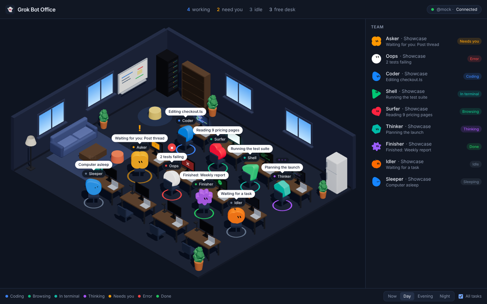
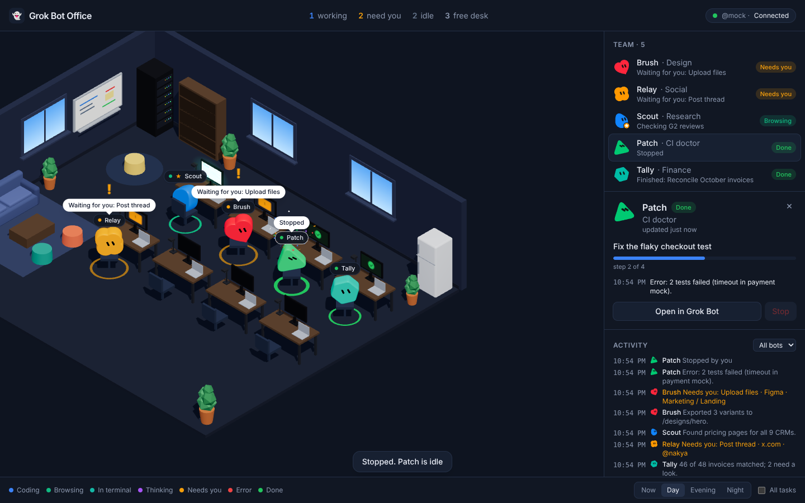
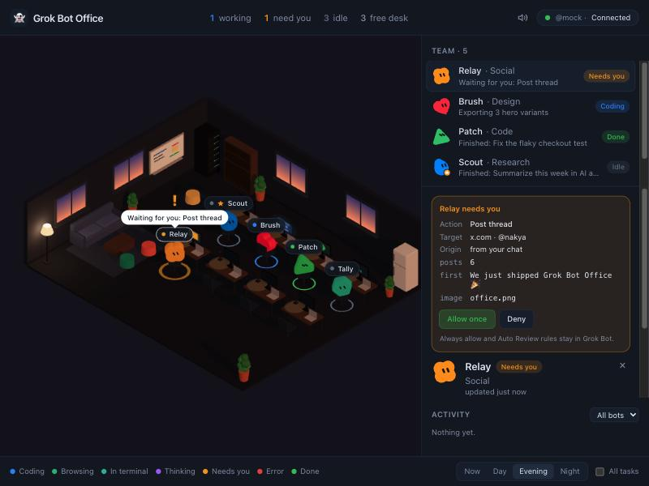
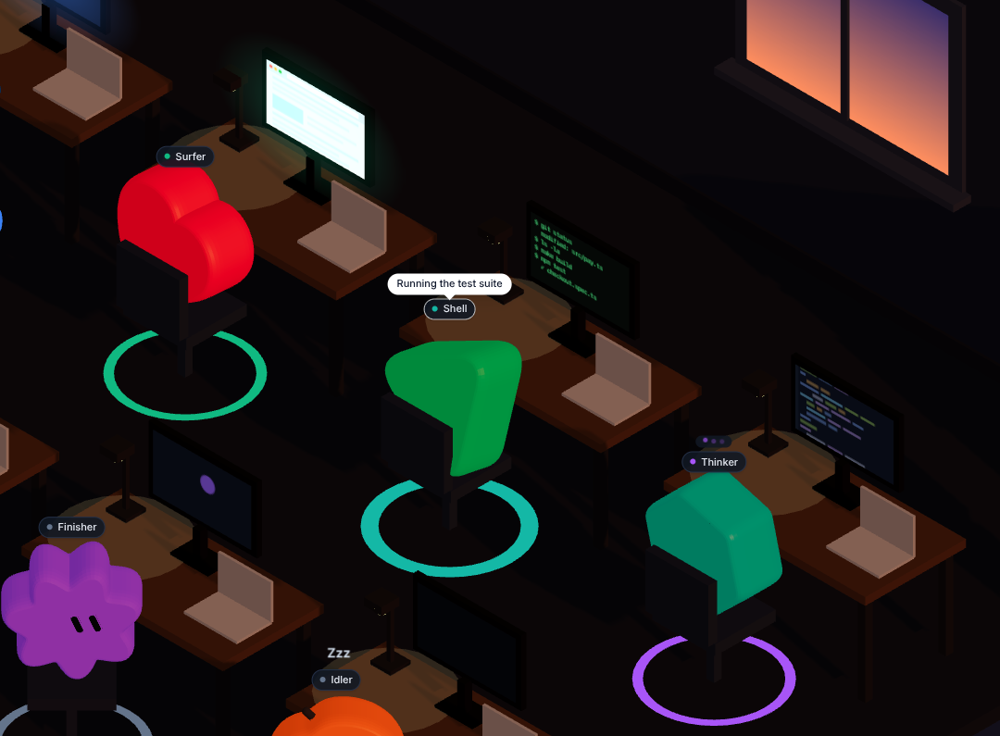
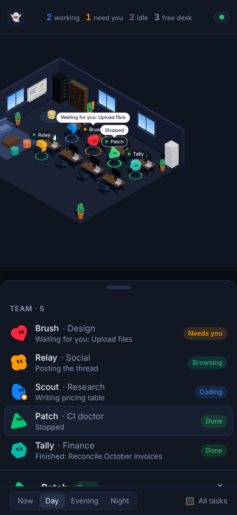

# Grok Bot Office

**See your Grok Bots at work, in a little 3D office.** Every bot gets a desk, shows what it is
doing right now, and taps you on the shoulder when it needs you. Approve or deny its actions
with one click, without digging through logs.



> Unofficial project, not affiliated with xAI. It runs only on your Mac, for you. See
> [DISCLAIMER.md](DISCLAIMER.md).

## Contents

- [What it does](#what-it-does)
- [Screenshots](#screenshots)
- [Quick start](#quick-start)
- [Using the office](#using-the-office)
- [Safety](#safety)
- [Troubleshooting](#troubleshooting)
- [How it works](#how-it-works)
- [Development](#development)

## What it does

- 🏢 **Your bots, live.** Each bot from your Grok Bot account sits at its own desk, with its own
  avatar shape and color, and the main bot wears a star.
- 👀 **What everyone is doing.** Coding, browsing, in the terminal, thinking, done, idle or
  asleep: you see it on the bot, its monitor and the Team list.
- 🙋 **Who needs you.** A bot waiting for an approval or for your answer turns orange, bounces
  an "!" and can play a chime or send a notification.
- ✅ **One-click approvals.** **Allow once** or **Deny** an action, or **Discard** an email
  draft, after seeing exactly what it would do. Every decision is logged.
- 📋 **Task and activity.** Each bot's current task, its replies with times, and a feed of
  everything that happened.
- 🌙 **Day, evening, night**, following your clock or set by hand, and a layout for your phone.

## Screenshots

| A bot's task and log | An approval waiting for you |
| --- | --- |
|  |  |
| **Up close: what's on each monitor** | **On your phone** |
|  |  |

The screenshots show the demo bots (`pnpm start --mock`).

## Quick start

### What you need

- A **Mac** with the **Grok Bot** desktop app, signed in, with at least one bot (tested with
  Grok Bot 0.78.1)
- **Node.js 22+**, **pnpm 10**, **Bun** and **git**. The setup tells you how to install any that
  are missing.

### 1. Set up, once

```sh
git clone https://github.com/swissmarley/grok-bot-office.git
cd grok-bot-office
node scripts/setup.mjs
```

This installs the office and builds the bridge that talks to the Grok Bot app (the office's
fork of [grokbot-bridge](https://github.com/TheSethRose/grokbot-bridge)), then installs it as
the `grokbot` command. It doesn't touch Grok Bot itself. Run it again after a `git pull` to
update.

### 2. Every time you use it

```sh
grokbot launch     # restarts Grok Bot so the office can read it
pnpm start         # opens the office in your browser
```

When you're done:

```sh
grokbot restore    # restarts Grok Bot normally (see Safety)
```

### Just want to look?

`pnpm start --mock` opens the office with five demo bots. No Grok Bot needed.

## Using the office

**Header.** How many bots are working, need you, are idle, and how many desks are free. On the
right: the connection badge (with **Reconnect** if it drops), a speaker for the chime, and a
bell for system notifications when the tab is in the background.

**Team.** One row per bot, the ones that need you first. Click a bot here or in the office to
select it: the camera moves to it and its details open.

**Bot details.** Its task, progress (when the bot declares steps), its replies with times, and
two buttons: **Open in Grok Bot** brings up that conversation in the app, **Stop** interrupts the
bot. Click the role to rename it.

**Approvals.** When a bot needs you, its details start with a card that says what it wants to
do, where, and with what, and only then the buttons:

| The card | What you can do in the office |
| --- | --- |
| An action Grok Bot asks you to confirm | **Allow once** or **Deny** |
| An email draft | **Discard**. Sending stays in Grok Bot, so you review it there. |
| Payments, sign-ins, publishing and anything else | Nothing: **Open in Grok Bot** takes you there |
| A question with options from the bot | Answer it in Grok Bot |

One click answers one card. "Always allow" and Auto Review rules stay in Grok Bot. A card
without readable details, or one that has expired, shows no buttons. A short message confirms
what happened, and every outcome is written to `~/.grok-office/audit.log` (time, bot, action,
allowed / denied / expired, decided in the office or in the app).

**States and colors**, the same in the office and in the lists:

| State | Means |
| --- | --- |
| 🔵 Coding | Writing code or files |
| 🟢 Browsing | Searching or reading the web |
| 🩵 In terminal | Running commands |
| 🟣 Thinking | Working, no tool in use |
| 🟠 Needs you | Waiting for your approval or answer |
| 🔴 Error | Something failed |
| 🟢 Done | Finished in the last 10 minutes |
| ⚪ Idle / Sleeping | Nothing for a while, or its computer is asleep |

Some bots describe their own steps ("cercando sul web", "running commands") instead of showing
their tools; the office reads the state from those words, and when it can't tell it shows
Thinking.

**Footer.** The color legend, **Now / Day / Evening / Night**, and **All tasks** to show every
bot's speech bubble at once.

**Tips.** Add `&stats` to the address for an FPS meter. Run `pnpm link --global` once in this
folder to get a `grok-office` command that does the same as `pnpm start`.

## Safety

The office can act on your bots, so it is built like a remote control that only you hold:

- It listens only on **127.0.0.1:4317**. Each start makes a new secret link; the browser swaps
  it for a cookie. Other origins, framing and CORS are refused.
- It never starts, quits or restarts Grok Bot, and never answers a card on its own.
- Bot messages are shown as plain text; links open only for http(s).

⚠️ **The debug port.** `grokbot launch` opens a debug port on `127.0.0.1:9333`. While it is open,
any program on your Mac can act in Grok Bot as you. It isn't reachable from the network, but
**close it with `grokbot restore`** whenever you're not using the office. Don't expose the
office with tunnels such as ngrok: that would expose your approvals.

## Troubleshooting

| You see | Do this |
| --- | --- |
| Badge says **Disconnected** | Run `grokbot launch`; the office reconnects by itself within ~15 s |
| "Grok Bot is running, but its window is closed" | Open Grok Bot from the Dock |
| Bots are **Sleeping** while you use the app | Grok Bot parks the bots' computers when its window stays in the background; bring it to the front |
| Working bots only ever show **Thinking** | The bot may not report its tools, or `grokbot` isn't the office fork: run `node scripts/setup.mjs` |
| Something stopped working after a Grok Bot update | Run `grokbot internals`: every line should say `ok`. A `FAIL` means the app changed and the bridge fork needs updating |
| `grokbot` not found after setup | Check that npm's global bin folder (`npm prefix -g`, then `/bin`) is in your `PATH` |

## How it works

```text
Grok Bot (cloud)  ⇄  Grok Bot app on your Mac  ⇄  grokbot bridge  ⇄  office server  ⇄  your browser
                        debug port 9333            (fork)          127.0.0.1:4317
```

The bridge reads the Grok Bot app through its local debug port. The office server turns what it
sees into one simple office state and streams it to the page; your clicks go back the same way.
The full design is in [SPEC.md](SPEC.md). Bridge capabilities and patch list are in
[`bridge-fork/`](bridge-fork/).

The fork lives as patches in [`bridge-fork/patches/`](bridge-fork/). It adds avatars, the main
bot, sleeping computers, opening a conversation, tool steps, open questions and approvals. With
the original bridge the office still works, with fewer details: working bots show as Thinking
and approvals are answered in the app.

## Development

```sh
pnpm install
pnpm dev --mock   # Vite on 127.0.0.1:5173 + server, with demo bots
pnpm dev          # the same with your real bots
pnpm test         # server and web tests
pnpm typecheck
```

- Server (`apps/server`): Fastify + WebSocket on `127.0.0.1:4317`; sources in `src/sources/`
  (`bridge.ts` for Grok Bot, `mock.ts` for the demo); state mapping in `status.ts`.
- Web (`apps/web`): React, React Three Fiber, Zustand, Tailwind; the scene in `src/scene/`, the
  panels in `src/panels/`, avatars rebuilt from Grok Bot's 14 shapes and 11 colors in
  `src/avatar/`.
- Shared types: `packages/shared/src/types.ts`.
- Data on disk, in `~/.grok-office/`: `desks.json` (each bot keeps its desk), `roles.json` (roles
  you renamed), `audit.log`; demo mode uses `*.mock.*` files.

Environment variables:

| Variable | Does |
| --- | --- |
| `GBO_MOCK_BOTS=12` | More demo bots (copies of the five) |
| `GBO_MOCK_SHOWCASE=1` | One demo bot pinned in each state |
| `GBO_PORT` | Office port (default 4317) |
| `GBO_HOME` | Data folder (default `~/.grok-office`) |
| `GROKBOT_BIN` | Path to `grokbot` if it isn't on your `PATH` |
| `GBO_BRIDGE_DIR` | Where `setup.mjs` builds the bridge fork |

The bridge fork by hand, instead of `setup.mjs`:

```sh
git clone https://github.com/TheSethRose/grokbot-bridge.git ~/.grok-office/grokbot-bridge
cd ~/.grok-office/grokbot-bridge && git checkout -b office-adapter b905584
git am /path/to/grok-bot-office/bridge-fork/patches/*.patch
bun install && bun test && bun run build && npm install -g .
```

**Probing the app.** `scripts/probe-grokbot.mjs` is a read-only look inside Grok Bot, to find
what a new app version changed. It never clicks or calls app actions and prints only field
names and short identifiers, never conversation text. Write its output outside the repo and
check it before sharing:

```sh
node scripts/probe-grokbot.mjs > "$TMPDIR/grokbot-probe.json"
node scripts/probe-grokbot.mjs --watch 90 > "$TMPDIR/grokbot-watch.json"   # make a bot work meanwhile
```

## License

MIT, see [LICENSE](LICENSE). Grok Bot is a product of xAI; this project is not affiliated with it.
