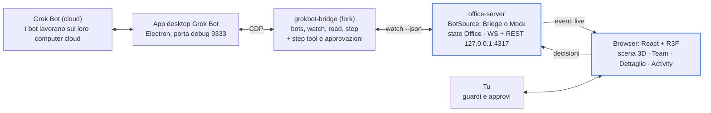

# Grok Bot Office — istruzioni di build

28 ottobre 2026 · Nakya

## Cosa stiamo costruendo

Grok Bot Office è una web app locale che mostra i tuoi Grok Bot come personaggi in un ufficio isometrico 3D: ogni bot ha una scrivania, uno stato in tempo reale e le approvazioni in attesa si danno da lì. Sostituisce la lettura dei log con un colpo d'occhio sulla stanza.

Funzioni dichiarate nel post di @maestrooth:

- Colleghi il tuo account Grok Bot e i bot compaiono nell'ufficio.
- Ogni bot ha scrivania, monitor e laptop.
- Approvi o rifiuti un task del bot con un click.
- Vedi chi sta programmando, lavorando o dormendo.

Dettagli visibili nello screenshot, da replicare:

| Zona | Cosa mostra |
| --- | --- |
| Header | Logo "Grok Bot Office", badge account collegato (@handle · Connected), pulsante audio |
| Contatori | working, need you, idle, free desk (es. 5 · 0 · 0 · 1) |
| Scena | Stanza isometrica con 6 scrivanie, divano, tappeti, piante, libreria, rack, finestre notturne; fumetti con il task corrente sopra i bot |
| Team | 5 bot con nome, ruolo, attività corrente e pillola di stato (es. Scout · Research · Browsing) |
| Dettaglio bot | Task ("Launch thread on X"), barra "step 4 of 4", log con orari, newest first |
| Activity | Feed globale degli eventi, newest first |
| Footer | Legenda stati (Coding, Browsing, In terminal, Thinking, Needs you, Error, Done), selettore Now / Day / Evening / Night, toggle All tasks |
| Toast | Conferma azione, es. "Approved. Relay is posting the thread" |

L'articolo collegato nel post (one-person company su Grok Bot) è un tema separato e resta fuori da questa build.

## Da dove arrivano i dati

Grok Bot non ha un'API pubblica: l'unica via oggi è [grokbot-bridge](https://github.com/TheSethRose/grokbot-bridge) (MIT, non ufficiale), che pilota l'app desktop Electron via Chrome DevTools Protocol su 127.0.0.1. L'ufficio usa il bridge come adapter e ne colma i buchi.

| Serve all'ufficio | Cosa dà il bridge | Gap da colmare |
| --- | --- | --- |
| Elenco bot + stato | `grokbot bots --json`: id, working, needs input, unread | Nessuno |
| Aggiornamenti live | `grokbot watch --json`: eventi working, idle, needs_input, message | Nessuno |
| Testo del task e log | `grokbot read --json`: messaggi con key e orario | Gli step dei tool sono esclusi |
| Coding / Browsing / Terminal / Thinking | Non esposto | Leggere gli step dei tool dal transcript store (fork di `src/bot.ts`) |
| Approva / rifiuta | Il bridge non tocca mai le card di approvazione | Vedi sezione Approvazioni |
| Stop di un bot | `grokbot stop <bot>` | Nessuno |
| Uso settimanale | `grokbot usage` | Nessuno |

Requisiti del bridge: app desktop Grok Bot loggata con almeno un bot, Node.js 22+ o Bun, macOS (testato su Grok Bot 0.71.2; Windows e Linux non testati). `grokbot launch` riavvia l'app con la porta debug 9333, `grokbot restore` la chiude.

Due comportamenti dell'app da gestire nella UI:

- Il computer del bot va in sleep quando il Mac è bloccato o la finestra di Grok Bot resta in background 10 minuti; i turni dei bot continuano in cloud.
- Le approvazioni nate senza di te (routine, trigger, messaggi da altri bot) scadono dopo circa 10 minuti e diventano Expired ([docs xAI](https://docs.x.ai/grok-bot/approvals-security-and-privacy)).

## Architettura

Due pezzi da costruire, un server locale e una UI nel browser, appoggiati al bridge che legge l'app desktop.



I dati salgono dal cloud all'app, il bridge li legge via CDP e il server li spedisce al browser; le tue decisioni fanno il percorso inverso. In modalità mock il server ignora il bridge. In blu i due pezzi da costruire.

Struttura del repo:

```text
grok-bot-office/
  apps/server/src/   index.ts, config.ts, office-state.ts, ws.ts
  apps/server/src/sources/   mock.ts, bridge.ts
  apps/web/src/   scene/, panels/, store.ts, theme.css
  packages/shared/src/   types.ts
```

Il fork del bridge vive in un repo separato e aggiunge solo `adapter/grokbot-internals.ts` per step dei tool e approvazioni.

## Modello dati, stati ed eventi

Il server normalizza tutto in un solo stato `Office` e spedisce al browser eventi tipizzati; la UI non conosce il bridge.

```ts
type BotStatus =
  | 'coding' | 'browsing' | 'terminal' | 'thinking'
  | 'needs_you' | 'error' | 'done' | 'idle' | 'sleeping';

interface Bot {
  id: string; name: string; role: string;   // role: modificabile, default = prima parola della description
  color: string; deskIndex: number;
  status: BotStatus; activity: string;      // es. "Reading 9 pricing pages"
  unread: number; updatedAt: string;
  task?: Task; approval?: Approval;
}

interface Task {
  title: string;                            // dal tuo ultimo messaggio, max 60 caratteri
  log: { at: string; text: string }[];      // risposte del bot nel turno, newest first
  step?: { index: number; total: number };  // solo se il bot dichiara un piano, altrimenti barra indeterminata
}

interface Approval {
  id: string; botId: string;
  action: string; target: string; inputs: Record<string, unknown>;
  origin: 'chat' | 'routine' | 'trigger' | 'bot';
  createdAt: string; expiresAt?: string;    // +10 min se origin != 'chat'
}

type OfficeEvent =
  | { type: 'snapshot'; bots: Bot[]; desks: number }
  | { type: 'bot.updated'; bot: Bot }
  | { type: 'activity'; botId: string; at: string; text: string }
  | { type: 'approval.requested'; approval: Approval }
  | { type: 'approval.resolved'; id: string; result: 'allowed' | 'denied' | 'expired' }
  | { type: 'connection'; state: 'connected' | 'disconnected'; handle?: string };
```

Come si ricava lo stato da quello che espone il bridge:

| Segnale | Stato ufficio |
| --- | --- |
| `needs_input` (card o domanda aperta) | needs_you |
| working + ultimo tool = editor, file, git | coding |
| working + ultimo tool = browser | browsing |
| working + ultimo tool = shell | terminal |
| working senza tool attivo | thinking |
| tool fallito o messaggio d'errore del bot | error |
| idle entro 10 min dall'ultima risposta | done |
| idle oltre 10 min | idle |
| idle oltre 30 min o computer del bot in sleep | sleeping |

Le soglie stanno in `config.ts`. Senza il fork per gli step dei tool, i quattro stati di lavoro collassano in `thinking`.

Scrivanie: assegnazione stabile per id del bot, salvata in `~/.grok-office/desks.json`; `free desk` = scrivanie totali meno bot. Colore: palette fissa scelta da hash dell'id.

## La scena dell'ufficio

La stanza è una scena React Three Fiber con camera ortografica isometrica, costruita da primitive low-poly: nessun asset esterno obbligatorio. Se servono mobili più ricchi, usa solo modelli CC0 (es. i kit furniture di Kenney).

Setup:

- `@react-three/fiber` + `@react-three/drei` (`OrthographicCamera`, `Html`, `RoundedBox`, `ContactShadows`).
- Camera: rotazione Y 45°, X circa −35,26°, zoom limitato, pan disattivato di default.
- Stanza 12 × 10 unità, due pareti con finestre, pavimento scuro.
- Scrivanie in griglia 2 × 4 (8 posti): ognuna con monitor, laptop e sedia; mobili ripetuti con `Instances`.
- Arredo: divano + tappeto + lampada a stelo, libreria, rack server con LED, lavagna, frigo, piante, pouf.
- Bot: blob a forma di fantasmino (capsula + due occhi), colore del bot, seduto alla sua scrivania; targhetta `Html` con nome e pallino di stato.
- Fumetto con l'attività (max 40 caratteri): visibile per bot selezionato, in hover, in needs_you o con All tasks attivo.

Animazione per stato:

| Stato | Bot | Monitor | Effetto |
| --- | --- | --- | --- |
| coding | Ondeggia, braccia che battono | Righe di codice che scorrono | Glow blu |
| browsing | Guarda lo schermo | Finestra browser con scroll | Glow verde |
| terminal | Fermo, chino | Testo monospazio verde | Cursore che lampeggia |
| thinking | Fluttua lento | Spento a metà | Tre puntini sopra la testa |
| needs_you | Si gira verso la camera | Card gialla | "!" giallo che rimbalza + anello pulsante |
| error | Si affloscia | Schermo rosso | Icona errore |
| done | Piccolo salto | Spunta verde | Coriandoli per 2 s |
| idle | Fermo | Screensaver | Nessuno |
| sleeping | Occhi chiusi, appoggiato | Spento | "Zzz" |

Ora del giorno: Now segue l'orologio locale; Day, Evening e Night sono preset di luce ambientale e direzionale, cielo nelle finestre (stelle di notte) e lampade da scrivania accese dalla sera.

Interazioni: click su un bot lo seleziona e la camera si centra piano; click a vuoto deseleziona. Rispetta `prefers-reduced-motion` (niente rimbalzi, solo cambi di colore). Obiettivo 60 fps su un Mac M1 con 12 bot, `frameloop="demand"` quando nulla si muove.

## Pannelli UI

Layout desktop: scena a sinistra, sidebar fissa di 360 px a destra. Su mobile la scena sta in alto e la sidebar diventa un bottom sheet. Tema scuro di default.

- **Header**: logo, contatori (working, need you, idle, free desk), badge account a destra con stato connessione e pulsante Riconnetti se cade.
- **Team**: una riga per bot con avatar, nome, ruolo, attività corrente e pillola di stato; ordine needs_you, error, working, done, idle, sleeping.
- **Dettaglio bot**: nome, ruolo, "updated just now", titolo del task, barra step (o indeterminata), log con orari newest first, pulsanti Apri in Grok Bot e Stop. Se c'è un'approvazione, la card sta in cima.
- **Activity**: feed di tutti gli eventi newest first, filtrabile per bot, ultimi 200 in memoria.
- **Footer**: legenda colori, selettore Now / Day / Evening / Night, toggle All tasks.
- **Toast**: esito delle azioni ("Approved. Relay is posting the thread"), 4 s.
- **Audio**: suono breve su needs_you, toggle mute nell'header; notifica di sistema se la scheda non è in primo piano.

Colori di stato (token CSS, uguali in scena e pannelli):

| Stato | Token | Hex |
| --- | --- | --- |
| coding | `--st-coding` | #3B82F6 |
| browsing | `--st-browsing` | #10B981 |
| terminal | `--st-terminal` | #14B8A6 |
| thinking | `--st-thinking` | #A855F7 |
| needs_you | `--st-needs` | #F59E0B |
| error | `--st-error` | #EF4444 |
| done | `--st-done` | #22C55E |
| idle, sleeping | `--st-idle` | #64748B |

## Approvazioni con un click

Il click unico richiede di estendere il bridge, perché oggi non risponde alle card: si fa in due passi, prima la versione sicura e poi il fork.

**V1, solo visualizzazione.** Su `needs_input` il bot passa a needs_you e la card nell'ufficio mostra cosa si sa (bot, ultimo messaggio). Il pulsante Apri in Grok Bot porta l'app in primo piano su quella conversazione; l'approvazione si dà lì.

**V2, approva e rifiuta dall'ufficio.** Nel fork del bridge:

1. Trova nel renderer lo store della card di approvazione, con lo stesso metodo che il bridge usa per `stop` (chiamata all'azione interna, mai click simulati sul DOM).
2. Esponi `getPendingApproval(botId)` con azione, target e input, e `resolveApproval(id, 'allow_once' | 'deny')`.
3. Isola nomi di store e campi in un solo file `adapter/grokbot-internals.ts`, con test che falliscono chiari se l'app cambia.

Regole della card nell'ufficio:

- Mostra sempre azione, target, scope e input prima dei pulsanti; se non sono leggibili, niente pulsanti e solo Apri in Grok Bot.
- Solo **Allow once** e **Deny**. Always allow e le regole di Auto Review restano nell'app.
- Mai approvazioni automatiche, batch o da scorciatoia globale: un click per card.
- Countdown visibile per le card con scadenza; a zero la card diventa Expired e i pulsanti spariscono.
- Password, 2FA, CAPTCHA e pagamenti ("Take over") non si gestiscono dall'ufficio: card "Serve te nell'app".
- Ogni decisione va in `~/.grok-office/audit.log` (ora, bot, azione, esito).

## Sicurezza e limiti

L'ufficio può approvare azioni reali dei tuoi bot, quindi va trattato come un telecomando: solo locale, solo tuo.

- La porta debug 9333 permette a qualsiasi processo locale di agire nell'app come te. Chiudila con `grokbot restore` quando non usi l'ufficio.
- Il server dell'ufficio ascolta solo su 127.0.0.1, genera un token casuale all'avvio (nell'URL aperto, poi cookie httpOnly), controlla l'header Origin sul WebSocket e rifiuta CORS.
- Niente tunnel pubblici (ngrok e simili): esporre la UI significa esporre le approvazioni.
- I messaggi dei bot possono contenere testo preso dal web: renderizzali come testo, niente `dangerouslySetInnerHTML`, link con `rel="noopener noreferrer"`.
- Il bridge legge store interni dell'app: un aggiornamento di Grok Bot può romperlo. Mostra la versione dell'app rilevata e, se l'adapter fallisce, degrada a "solo stato" (working, idle, needs_you) invece di andare in crash.
- Progetto non ufficiale e non affiliato a xAI o Cursor; leggi i loro termini prima di pubblicarlo o distribuirlo.

## Milestone e criteri di accettazione

Si parte dalla modalità mock, così scena e pannelli si costruiscono senza toccare l'app; il bridge entra solo alla M3.

1. **M0 · Mock**: generatore di eventi con 5 bot (Scout Research, Brush Design, Patch Code, Tally Finance, Relay Social) che girano tra tutti gli stati.
   - [ ] `pnpm dev --mock` mostra l'ufficio senza Grok Bot installato
   - [ ] Ogni stato compare almeno una volta in 2 minuti
2. **M1 · Scena**: stanza, scrivanie, bot, animazioni di stato, ora del giorno.
   - [ ] Click su un bot lo seleziona e centra la camera
   - [ ] Night accende lampade e stelle; reduced motion toglie i rimbalzi
3. **M2 · Pannelli**: header, Team, Dettaglio, Activity, footer, toast.
   - [ ] Contatori e scena restano coerenti con lo stato del server
   - [ ] Layout mobile utilizzabile a 390 px di larghezza
4. **M3 · Bridge live**: adapter su `bots`, `watch`, `read`, con riconnessione.
   - [x] Un messaggio mandato a un bot dall'app compare nel log entro 2 s
   - [x] Chiudendo l'app il badge passa a Disconnected e si riprende da solo
5. **M4 · Attività fini**: fork per gli step dei tool, mapping coding / browsing / terminal.
   - [x] Un bot che apre il browser passa a browsing
   - [x] Se il fork fallisce, gli stati collassano in thinking senza errori in UI
6. **M5 · Approvazioni**: V1, poi V2.
   - [x] V1: needs_you compare entro 2 s e Apri in Grok Bot porta sulla conversazione giusta
   - [ ] V2: Allow once e Deny funzionano, l'esito è nel toast e in `audit.log`
   - [ ] Card scadute diventano Expired senza pulsanti
7. **M6 · Rifinitura**: audio, notifiche, avvio con un comando (`npx grok-office`) che lancia server e browser.
   - [x] 60 fps su M1 con 12 bot
   - [x] README con setup, rischi della porta debug e `grokbot restore`

## Prompt per Claude Code

Incolla questo prompt in Claude Code dalla root di questa repo. Se vuoi coerenza con Conductor o Agent Studio, aggiungi il repo alla sessione e la riga indicata in fondo.

```text
Costruisci "Grok Bot Office": una web app locale che mostra i miei Grok Bot come personaggi in un ufficio isometrico 3D, con stato live e approvazioni. La specifica completa è in SPEC.md: seguila, e se qualcosa non è chiaro chiedi prima di inventare.

Stack
- Monorepo pnpm: apps/server (Node 22, TypeScript, Fastify + ws) e apps/web (Vite, React 18, TypeScript, @react-three/fiber, @react-three/drei, Zustand, Tailwind).
- packages/shared: tipi Bot, Task, Approval, OfficeEvent esattamente come in SPEC.md.
- Nessun asset 3D esterno: tutto da primitive low-poly.

Server
- Ascolta solo su 127.0.0.1:4317. Token casuale all'avvio, controllo Origin sul WebSocket, niente CORS.
- Due sorgenti intercambiabili dietro un'interfaccia BotSource: MockSource (5 bot: Scout, Brush, Patch, Tally, Relay, che girano tra tutti gli stati) e BridgeSource.
- BridgeSource avvia `grokbot watch --json` come processo figlio, legge `grokbot bots --json` all'avvio e `grokbot read <bot> --json --limit 20` quando un bot cambia stato. Riconnessione con backoff, evento connection.
- Normalizza tutto nello stato Office e manda al browser solo OfficeEvent (snapshot all'apertura, poi delta).
- Mapping stati e soglie come nella tabella di SPEC.md, soglie in config.ts.
- Scrivanie stabili in ~/.grok-office/desks.json; decisioni di approvazione in ~/.grok-office/audit.log.

Web
- Scena: camera ortografica isometrica, stanza 12x10 con 8 scrivanie (monitor, laptop, sedia), divano, tappeti, piante, libreria, rack, lavagna, finestre. Bot a forma di fantasmino colorato con targhetta e fumetto.
- Animazioni per ogni stato come da tabella; Now/Day/Evening/Night; prefers-reduced-motion rispettato.
- Sidebar 360 px: Team, Dettaglio bot, Activity. Header con contatori e badge connessione. Footer con legenda, ora del giorno, All tasks. Toast.
- Card di approvazione: solo Allow once e Deny, dettagli dell'azione sempre visibili prima dei pulsanti, countdown per le card con scadenza, mai approvazioni automatiche.
- Testo dei bot sempre renderizzato come testo semplice.

Ordine di lavoro
- Segui le milestone M0-M6 di SPEC.md. Fermati alla fine di ogni milestone, fammi vedere il risultato e spunta i criteri di accettazione.
- Comincia da M0: `pnpm dev --mock` deve mostrare l'ufficio senza Grok Bot installato.
- Le approvazioni V2 richiedono di estendere grokbot-bridge: prima di toccarlo, mostrami cosa hai trovato negli store interni e aspetta il mio ok.

[Opzionale] Riusa struttura delle cartelle, convenzioni e design token del repo <Conductor | Agent Studio>.
```
